# Especificación de Requisitos de Software (SRS)

## Barber King

**Proyecto:** Aplicación móvil para gestión de barbería
**Versión:** 1.1 (mejorada)
**Fecha:** 27 de noviembre de 2026
**Autores:** Yonanderson Marroquín, Hernando Botello
**Revisión:** Documento mejorado a partir del SRS original

---

## 1. Introducción

### 1.1 Propósito

Este documento especifica los requisitos de software de **Barber King**, una aplicación móvil multiplataforma que conecta clientes con barberos profesionales. Está dirigido a desarrolladores, analistas, testers y stakeholders del proyecto.

### 1.2 Ámbito del sistema

Barber King opera en barberías de Colombia (inicialmente municipios, con posibilidad de expansión nacional e internacional). Permite a clientes buscar barberos, consultar servicios y precios, reservar turnos, calificar y recibir recomendaciones de corte mediante inteligencia artificial. Los barberos gestionan su agenda, horarios, servicios, portafolio y ubicación.

### 1.3 Alcance

El sistema incluye:

- Aplicación móvil para Android (preparada para iOS y Web).
- API REST en Node.js para la lógica de negocio.
- Base de datos en Supabase (PostgreSQL).
- Almacenamiento de archivos en Cloudinary.
- Asesor de estilo con inteligencia artificial (Groq).
- Notificaciones y recordatorios de citas.

No incluye pasarela de pagos ni chat directo entre usuarios; la comunicación se realiza a través del asesor de IA.

### 1.4 Justificación

Los clientes enfrentan dificultad para encontrar barberos calificados cerca de su ubicación, falta de información sobre precios y disponibilidad, e imposibilidad de reservar con anticipación. Los barberos tienen visibilidad limitada, gestión manual de turnos y pérdida de clientes potenciales. Barber King resuelve estas problemáticas digitalizando la relación cliente-barbero.

### 1.5 Personal involucrado

| Nombre | Rol | Responsabilidades | Contacto |
| --- | --- | --- | --- |
| Yonanderson Marroquín | Analista de requisitos / Desarrollador | Levantamiento de requisitos, documentación técnica | yonandersonmarroquin13@gmail.com |
| Hernando Botello | Desarrollador / Analista de requisitos | Diseño de diagramas, implementación | hernandobotellovargas2007@gmail.com |

### 1.6 Definiciones, acrónimos y abreviaturas

- **Cliente:** persona que utiliza los servicios del barbero y reserva citas desde la app.
- **Barbero:** profesional que ofrece servicios de corte, afeitado y cuidado personal.
- **SRS:** Software Requirements Specification.
- **API:** Application Programming Interface.
- **BD:** Base de datos.
- **UI/UX:** Interfaz de usuario / Experiencia de usuario.
- **JWT:** JSON Web Token.
- **RLS:** Row Level Security.

### 1.7 Referencias

- Repositorio: github.com/Hernando2007/barber-king
- Backend: barber-king.onrender.com
- Documentación de Flutter: flutter.dev
- Documentación de Supabase: supabase.com/docs

### 1.8 Resumen

Este documento describe las características, funcionalidades y restricciones de Barber King. La Sección 1 presenta el propósito y alcance. La Sección 2 describe el sistema de forma general. La Sección 3 detalla los requisitos específicos, funcionales y no funcionales.

---

## 2. Descripción general

### 2.1 Objetivo general

Dar a conocer el trabajo de diferentes barberos y generar una forma rápida para que las personas encuentren un barbero según sus gustos y ubicación.

### 2.2 Objetivos específicos

- Implementar un sistema de registro y perfiles diferenciados para barberos y clientes.
- Desarrollar un motor de búsqueda con filtros por ubicación, precio, especialidad y calificación.
- Crear un sistema de reservas en tiempo real que sincronice la disponibilidad de los barberos.
- Integrar un sistema de calificaciones y reseñas verificadas.
- Ofrecer un asesor de estilo con inteligencia artificial que recomienda cortes a partir de una foto.

### 2.3 Perspectiva del producto

Barber King es una aplicación móvil gratuita que conecta la demanda de servicios de barbería con la oferta de profesionales. Elimina barreras como la búsqueda manual y las citas presenciales, ofreciendo una solución digital integral.

### 2.4 Características del usuario

- **Barberos:** digitalizan su agenda, amplían su visibilidad, gestionan reservas, muestran portafolio, precios y disponibilidad.
- **Clientes:** exploran opciones por ubicación, presupuesto y reseñas, y reservan turnos.
- **Administradores:** gestionan usuarios, servicios, barberos, citas y reseñas.

### 2.5 Restricciones generales

- Depende de que los barberos mantengan actualizada su disponibilidad en tiempo real.
- La precisión de la IA depende de la calidad, iluminación y ángulo de la foto.
- Requiere conexión a internet.
- Los grupos etarios objetivo son 16-17 y mayores de 18 años.

### 2.6 Funciones del producto

- Registro y gestión de perfiles (barberos y clientes).
- Búsqueda y filtrado de barberos.
- Reserva de turnos en tiempo real.
- Calificaciones y reseñas.
- Asesor de estilo con IA.
- Gestión de horarios y disponibilidad.
- Portafolio de trabajos y verificación de diplomas.
- Ubicación en tiempo real de barberos.

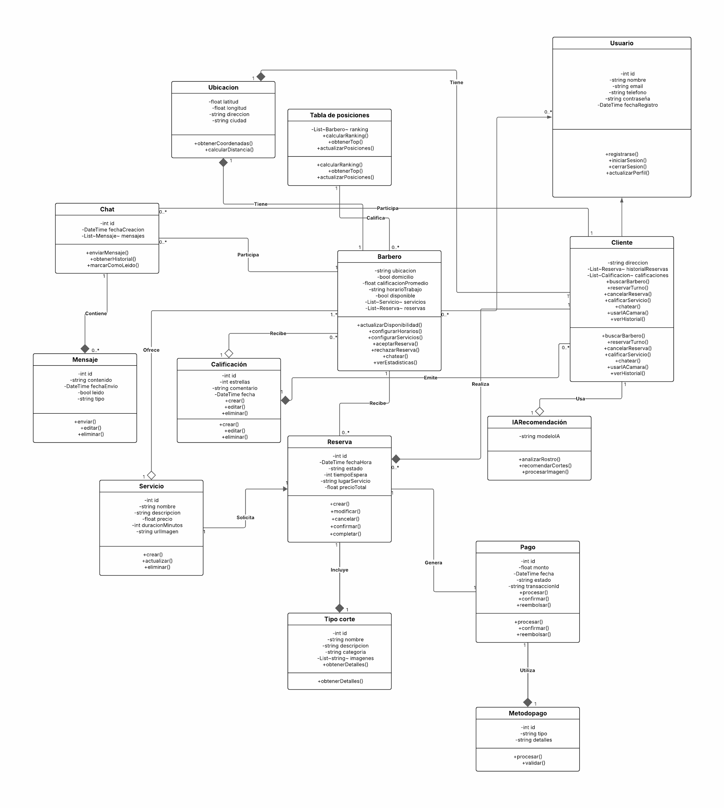

### 2.7 Características de los usuarios

| Rol | Descripción | Permisos principales |
| --- | --- | --- |
| Cliente | Busca barberos y reserva citas | Buscar, reservar, calificar, editar perfil |
| Barbero | Ofrece servicios y gestiona agenda | Gestionar horarios, servicios, portafolio, ubicación |
| Administrador | Gestiona el negocio | Usuarios, servicios, barberos, citas, verificaciones |

### 2.8 Suposiciones

- Los barberos mantendrán sus perfiles actualizados con información veraz.
- Los clientes priorizarán a los barberos mejor calificados.
- Las reseñas honestas generarán confianza en la plataforma.
- La IA reducirá la indecisión de nuevos usuarios.

---

## 3. Requisitos específicos

### 3.1 Requisitos funcionales

#### RF001 - Registrar barbero

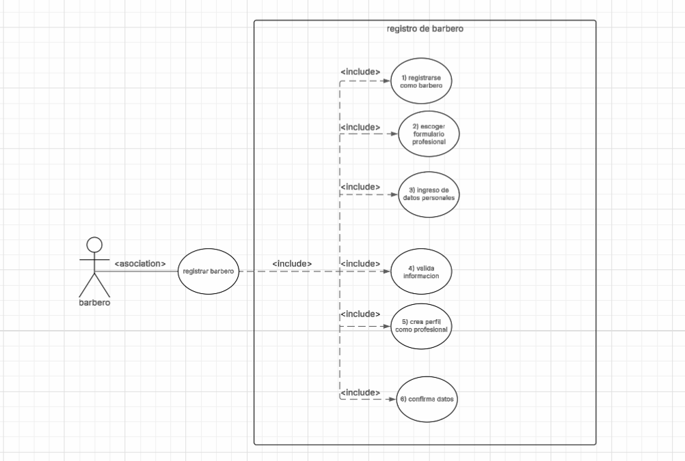

| Campo | Detalle |
| --- | --- |
| Nombre del caso de uso | Registrar barbero |
| Actor(es) | Barbero, sistema |
| Descripción | Permite a un barbero crear su perfil profesional. |
| Flujo principal | Seleccionar "Registrarse como Barbero" → completar datos personales, especialidad, experiencia, descripción, diploma y fotos → sistema valida → crea perfil → envía confirmación. |
| Resultado esperado | Barbero registrado con perfil profesional activo o pendiente de verificación. |

#### RF002 - Registrar cliente

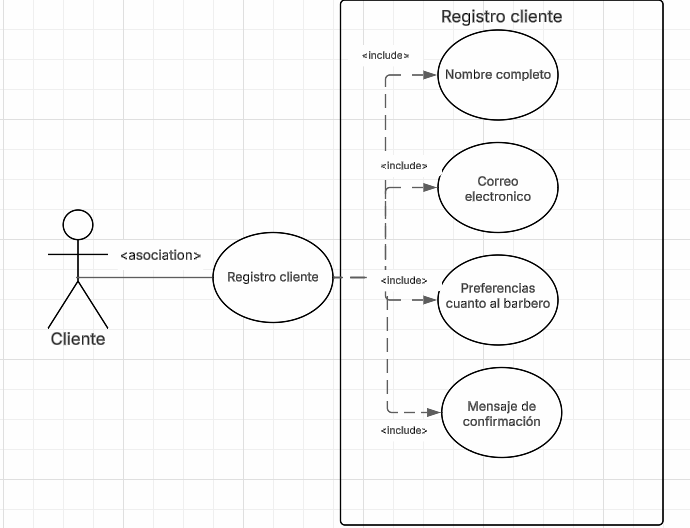

| Campo | Detalle |
| --- | --- |
| Nombre del caso de uso | Registrar cliente |
| Actor(es) | Cliente |
| Descripción | Permite crear una cuenta como cliente. |
| Flujo principal | Seleccionar "Registrarse como Cliente" → completar datos básicos → sistema valida → crea cuenta → envía confirmación. |
| Resultado esperado | Cliente registrado exitosamente. |

#### RF003 - Inicio de sesión (barbero)

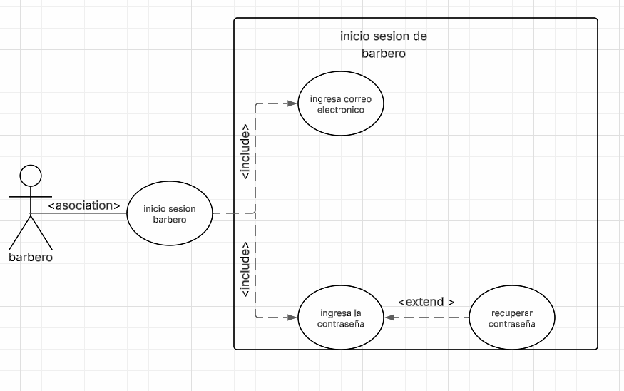

| Campo | Detalle |
| --- | --- |
| Nombre del caso de uso | Inicio de sesión (barbero) |
| Actor(es) | Barbero |
| Descripción | Permite al barbero acceder a su panel profesional. |
| Flujo principal | Ingresar correo y contraseña → sistema valida → acceso al panel. |
| Resultado esperado | Inicio de sesión exitoso. |

#### RF004 - Inicio de sesión (cliente)

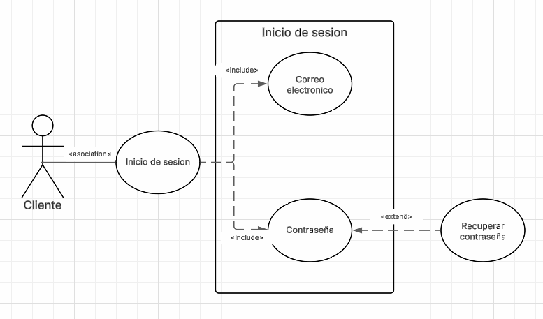

| Campo | Detalle |
| --- | --- |
| Nombre del caso de uso | Inicio de sesión (cliente) |
| Actor(es) | Cliente |
| Descripción | Permite al cliente acceder a la app. |
| Flujo principal | Ingresar correo y contraseña (o Google) → sistema valida → acceso al panel. |
| Resultado esperado | Inicio de sesión exitoso. |

#### RF005 - Recuperar contraseña

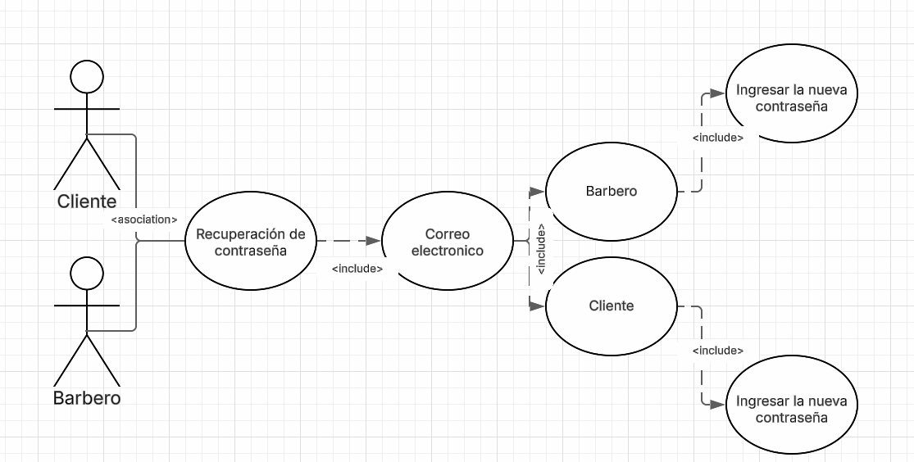

| Campo | Detalle |
| --- | --- |
| Nombre del caso de uso | Recuperar contraseña |
| Actor(es) | Barbero, cliente |
| Descripción | Permite restablecer la contraseña olvidada. |
| Flujo principal | Ingresar correo → sistema envía código → ingresar código y nueva contraseña → confirmar. |
| Resultado esperado | Contraseña restablecida exitosamente. |

#### RF006 - Perfil del barbero

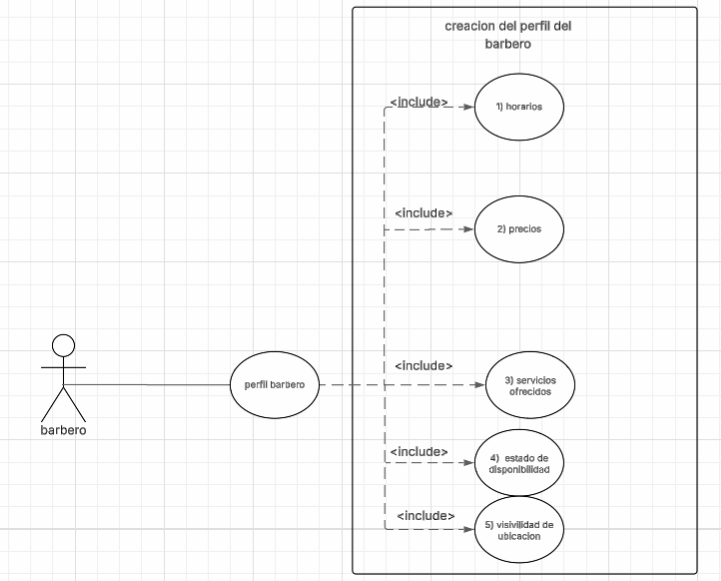

| Campo | Detalle |
| --- | --- |
| Nombre del caso de uso | Perfil del barbero |
| Actor(es) | Barbero |
| Descripción | Permite gestionar horarios, datos personales y laborales. |
| Flujo principal | Editar información personal, profesional, horarios, precios, servicios, ubicación, diploma. |
| Resultado esperado | Datos actualizados exitosamente. |

#### RF007 - Perfil del cliente

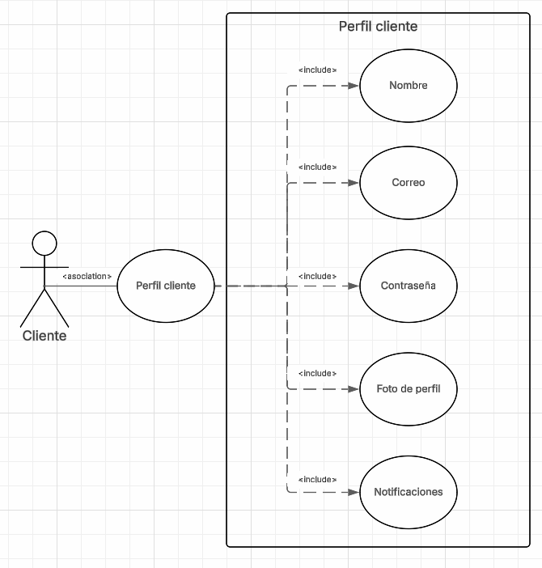

| Campo | Detalle |
| --- | --- |
| Nombre del caso de uso | Perfil del cliente |
| Actor(es) | Cliente |
| Descripción | Permite organizar el perfil del cliente. |
| Flujo principal | Editar información personal, preferencias de notificaciones. |
| Resultado esperado | Datos actualizados exitosamente. |

#### RF008 - Buscar barbero

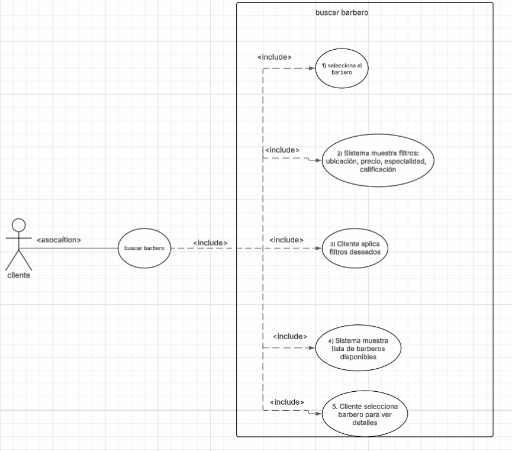

| Campo | Detalle |
| --- | --- |
| Nombre del caso de uso | Buscar barbero |
| Actor(es) | Cliente |
| Descripción | Permite encontrar barberos según criterios. |
| Flujo principal | Seleccionar "Buscar Barberos" → aplicar filtros (ubicación, precio, especialidad, calificación) → sistema muestra lista → seleccionar barbero. |
| Resultado esperado | Lista de barberos filtrados. |

#### RF009 - Reservar turno

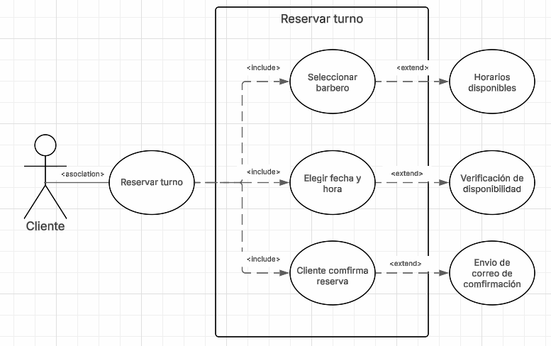

| Campo | Detalle |
| --- | --- |
| Nombre del caso de uso | Reservar turno |
| Actor(es) | Cliente |
| Descripción | Permite reservar un turno con un barbero. |
| Flujo principal | Seleccionar barbero → ver horarios disponibles → elegir fecha y hora → sistema verifica disponibilidad → confirmar reserva → sistema notifica a cliente y barbero. |
| Resultado esperado | Turno reservado exitosamente. |

#### RF010 - Gestionar horarios

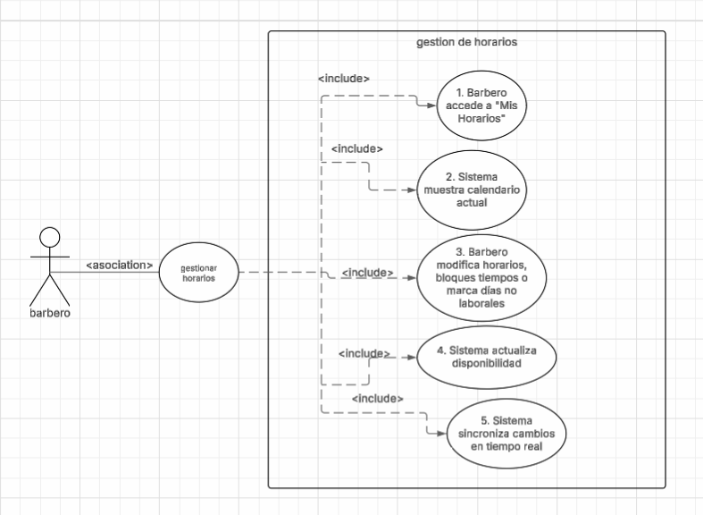

| Campo | Detalle |
| --- | --- |
| Nombre del caso de uso | Gestionar horarios |
| Actor(es) | Barbero |
| Descripción | Permite gestionar horarios de trabajo y disponibilidad. |
| Flujo principal | Acceder a "Mis Horarios" → modificar horarios, bloques de tiempo o marcar días no laborales → sistema actualiza disponibilidad. |
| Resultado esperado | Horarios actualizados correctamente. |

#### RF011 - Chat (asesor de IA)

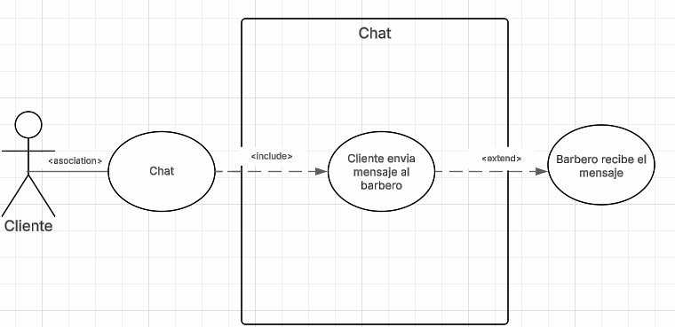

| Campo | Detalle |
| --- | --- |
| Nombre del caso de uso | Chat (asesor de IA) |
| Actor(es) | Cliente, barbero |
| Descripción | Permite consultar al asesor de estilo con IA. |
| Flujo principal | Escribir pregunta o subir foto → IA analiza y responde con recomendaciones basadas en el catálogo. |
| Resultado esperado | Respuesta generada exitosamente. |

#### RF012 - Sistema de calificación

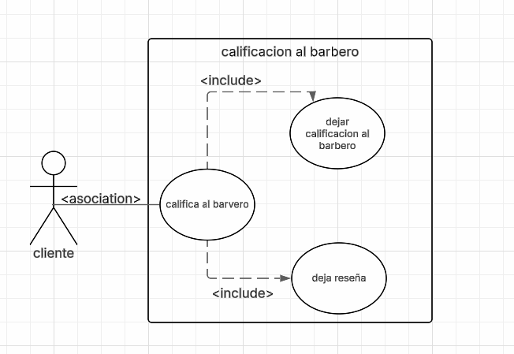

| Campo | Detalle |
| --- | --- |
| Nombre del caso de uso | Sistema de calificación |
| Actor(es) | Cliente |
| Descripción | Permite dejar calificación (1 a 5 estrellas) y reseña al barbero. |
| Flujo principal | Calificar con estrellas → escribir comentario opcional → publicar. |
| Resultado esperado | Comentario y calificación publicados. |

#### RF013 - Recomendación de corte por IA

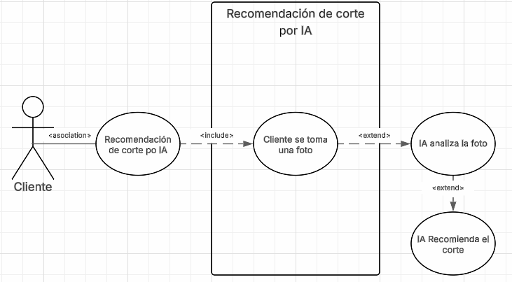

| Campo | Detalle |
| --- | --- |
| Nombre del caso de uso | Recomendación de corte por IA |
| Actor(es) | Cliente |
| Descripción | Ayuda a clientes indecisos a escoger un corte mediante análisis de una foto. |
| Flujo principal | Subir foto → IA analiza el rostro → IA recomienda corte. |
| Resultado esperado | Recomendación de corte generada. |

### 3.2 Requisitos no funcionales

| ID | Nombre | Propósito | Descripción | Prioridad |
| --- | --- | --- | --- | --- |
| RNF001 | Autenticación | Verificar identidad del usuario | Login con correo/contraseña y Google; tokens JWT | Alta |
| RNF002 | Seguridad | Proteger la información | Hash bcrypt, HTTPS, RLS en Supabase, rate limiting | Alta |
| RNF003 | Rendimiento | Respuesta rápida | Tiempo de respuesta < 3 segundos en operaciones comunes | Media |
| RNF004 | Usabilidad | Facilidad de uso | Interfaz intuitiva, accesible, con feedback claro | Alta |
| RNF005 | Confiabilidad | Operación sin errores | Manejo de errores y reintentos; logs en Sentry | Media |
| RNF006 | Disponibilidad | Servicio disponible | Backend en Render con reinicio automático | Media |
| RNF007 | Mantenibilidad | Facilidad de cambio | Código modular, pruebas unitarias | Media |
| RNF008 | Privacidad | Protección de datos | Política de privacidad, eliminación de datos, cifrado en tránsito | Alta |

### 3.3 Otros requisitos

- Compatibilidad con Android 8.0 o superior.
- Soporte para modo oscuro/claro según el sistema.
- Cumplimiento con las políticas de Google Play (Data Safety, política de privacidad, eliminación de cuenta).
- Soporte para español (Colombia).

---

## 4. Anexos

### 4.1 Tecnologías utilizadas

- **Frontend:** Flutter 3.47, Dart
- **Backend:** Node.js 20, Express 5
- **Base de datos:** Supabase (PostgreSQL)
- **Archivos:** Cloudinary
- **IA:** Groq (openai/gpt-oss-20b)
- **Correo:** Nodemailer (SMTP/Brevo/Resend)
- **Errores:** Sentry
- **Autenticación:** JWT, Google Sign-In

### 4.2 Repositorio y enlaces

- Repositorio: github.com/Hernando2007/barber-king
- Backend: barber-king.onrender.com
- Política de privacidad: barber-king.onrender.com/public/politica-privacidad.html

---

*Documento mejorado. Versión 1.1.*
